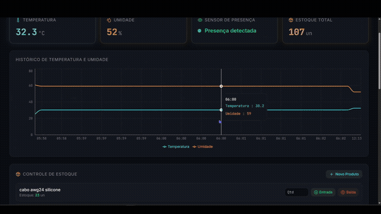
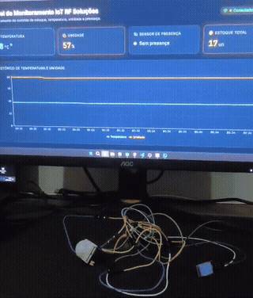

# IoT RF Soluções

ESP32 monitoring with DHT11 and PIR sensors, MQTT, a Python bridge, Supabase Realtime and a React dashboard.

[Live demonstration](https://brunnojob.github.io/IoT-RF-Solucoes/) · [Source](https://github.com/brunnojob/IoT-RF-Solucoes)

## Previews

### Software & telemetry
[](https://brunnojob.github.io/IoT-RF-Solucoes/media/iot.mp4)

### Hardware in operation
[](https://brunnojob.github.io/IoT-RF-Solucoes/media/iot2.mp4)

Animated previews loop automatically unless reduced-motion settings disable playback. The demo page plays both complete recordings muted, with controls. Recordings are not live telemetry.

## Run

```sh
npm ci
npm run dev
```

The landing page needs no login or database. The dashboard requires your ESP32, MQTT broker, `esp32.ino`, `mqtt_bridge_supabase.py` and a configured Supabase project. Its existing `admin` / `admin` login is a local UI gate, not production authentication.

SMS uses Twilio directly. Configure `TWILIO_ACCOUNT_SID`, `TWILIO_AUTH_TOKEN` and `TWILIO_FROM_NUMBER` as Edge Function secrets before deploying `send-sms-alert` to your Supabase project. No SMS is sent by the public demonstration.

GitHub Actions builds and publishes the site. Set **Settings → Pages → Source → GitHub Actions** once to enable hosting.

Credits: [brunnodev.store](https://brunnodev.store).
